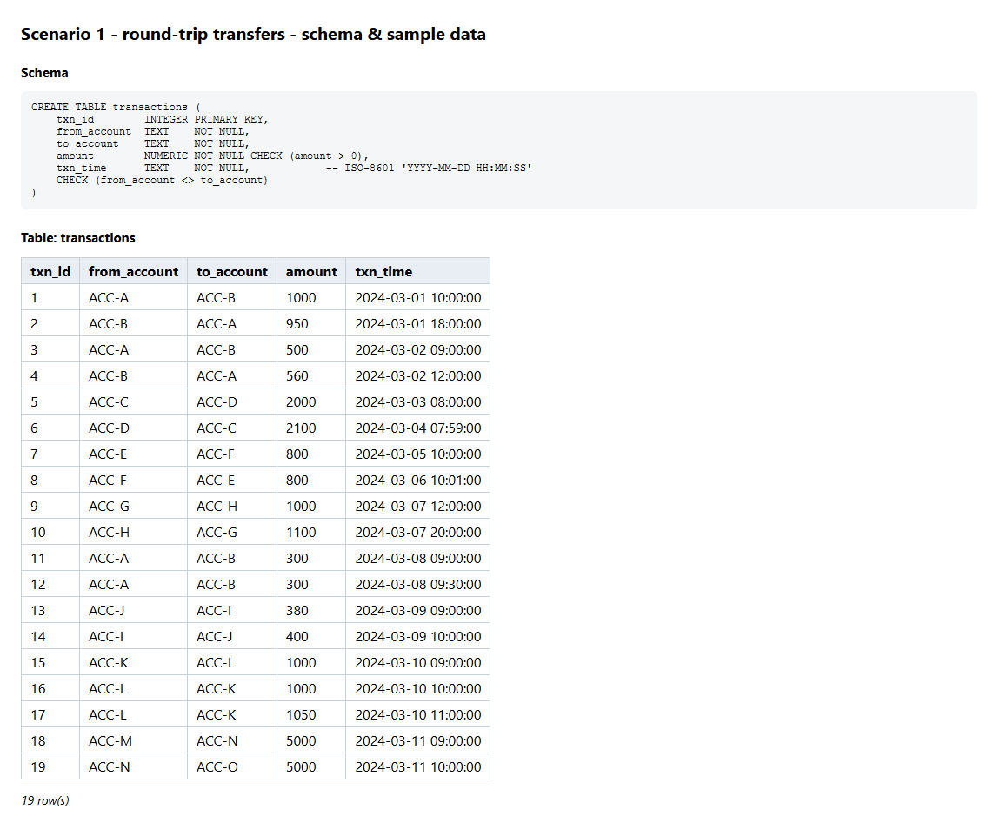
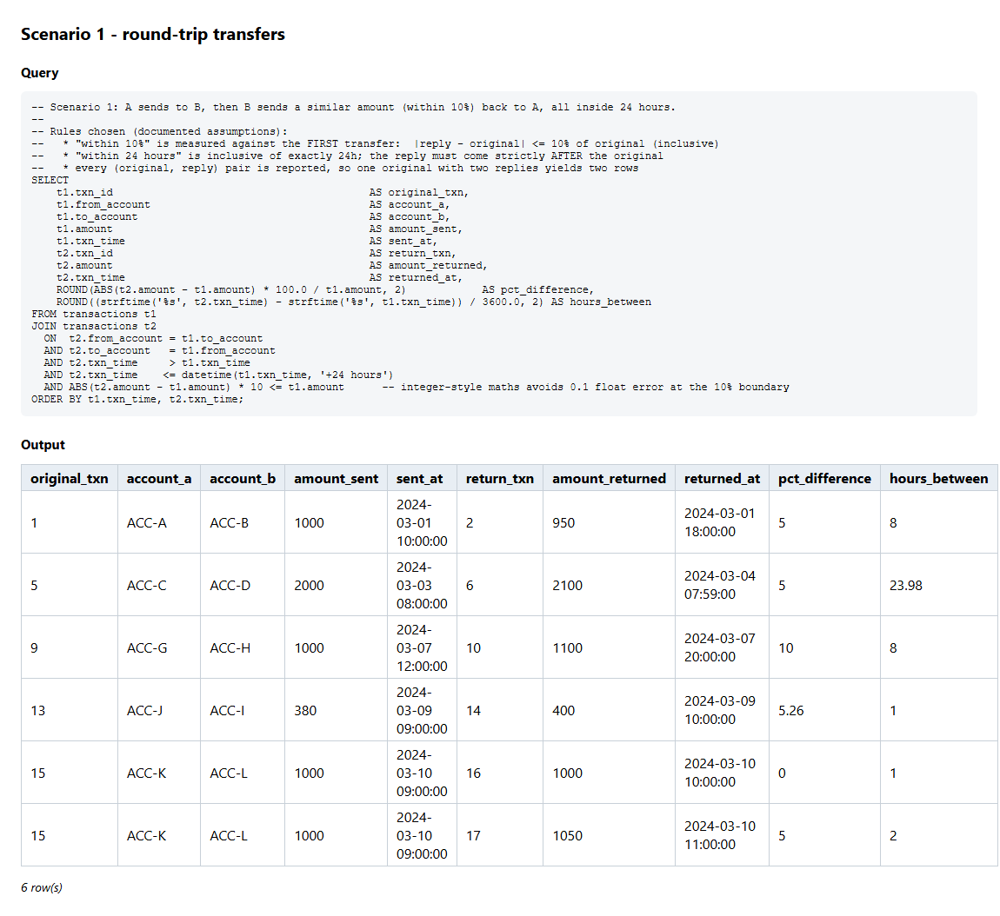
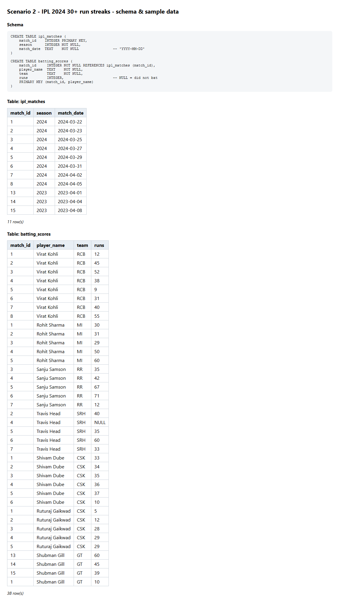
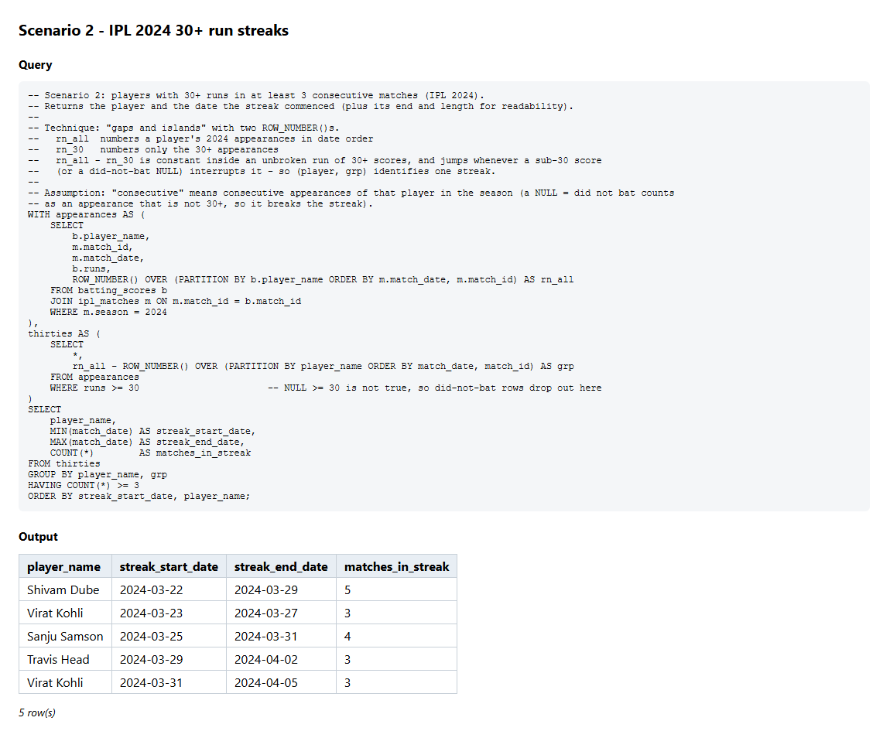
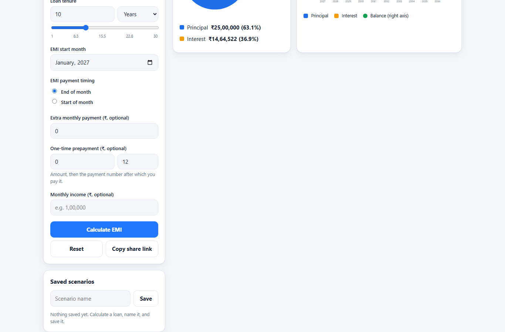
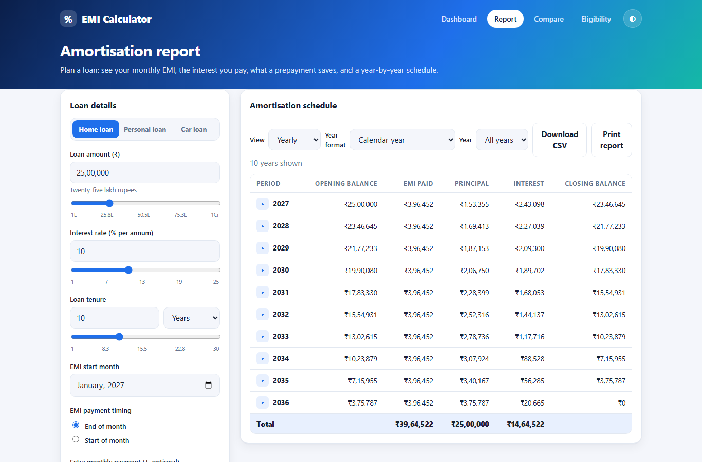
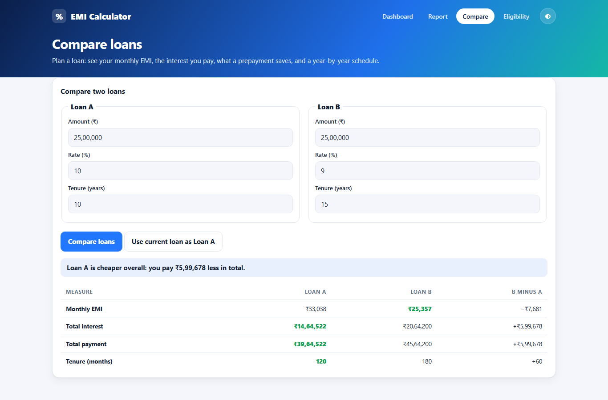
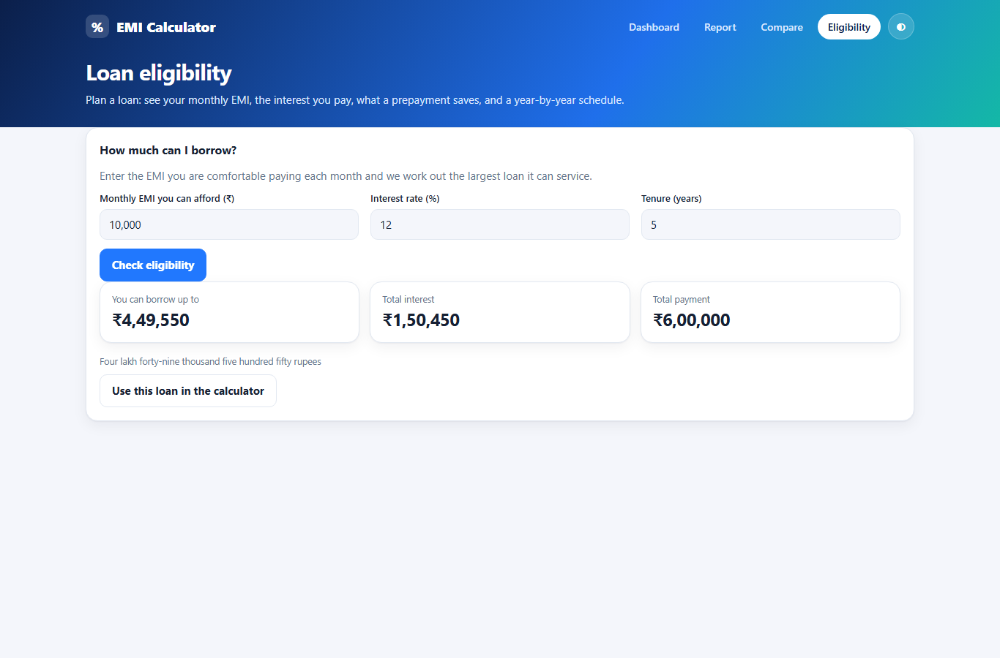

# Test execution results

_Generated by `npm run results` from the committed reports in `reports/`. Re-run the suites, then this script, to refresh._

## Summary

| Suite | Scenarios | Passed | Failed | Expected |
|---|---:|---:|---:|---|
| A2 - EMI web app (UI) | 89 | 89 | 0 | must pass |
| A3 - JSONPlaceholder POST /posts | 23 | 23 | 0 | must pass |
| Optional extra - mock catalogue API | 58 | 58 | 0 | must pass |
| A3 known gaps (strict 4xx expectation) | 7 | 0 | 7 | fails by design |
| Self-healing demo (broken locators) | 1 | 0 | 1 | fails by design |
| **Full run (`npm test`)** | **170** | **170** | **0** | must pass |

Failures in the last two suites are intentional: they document a third-party API that does not validate input and demonstrate broken locators for the self-healing exercise.

## Per feature file

### A2 - EMI web app (UI)

Report: `reports/cucumber/webapp.html`

| Feature | Scenarios | Passed | Failed |
|---|---:|---:|---:|
| EMI calculator web app (Section A) (`features/webapp/emi_app.feature`) | 21 | 21 | 0 |
| EMI calculator app - dynamic behaviour (loan types, timing, financial year, drill-down, live results) (`features/webapp/emi_app_dynamic.feature`) | 12 | 12 | 0 |
| EMI calculator app - prepayment, compare, export, saved scenarios, sharing (`features/webapp/emi_app_features.feature`) | 23 | 23 | 0 |
| EMI calculator app - loan insights and affordability (`features/webapp/emi_app_insights.feature`) | 12 | 12 | 0 |
| EMI calculator app - planning tools (lump-sum prepayment, cumulative chart, eligibility, print) (`features/webapp/emi_app_planning.feature`) | 21 | 21 | 0 |

### A3 - JSONPlaceholder POST /posts

Report: `reports/cucumber/jsonplaceholder.html`

| Feature | Scenarios | Passed | Failed |
|---|---:|---:|---:|
| JSONPlaceholder - POST /posts with boundary and invalid data (Section A3) (`features/jsonplaceholder/create_post.feature`) | 23 | 23 | 0 |

### Optional extra - mock catalogue API

Report: `reports/cucumber/api.html`

| Feature | Scenarios | Passed | Failed |
|---|---:|---:|---:|
| Genres and EMI endpoints (`features/api/genres_and_emi.feature`) | 16 | 16 | 0 |
| Titles catalogue API - GET /api/titles and /api/titles/{id} (`features/api/titles.feature`) | 42 | 42 | 0 |

### A3 known gaps (strict 4xx expectation)

Report: `reports/cucumber/known-gap.html`

| Feature | Scenarios | Passed | Failed |
|---|---:|---:|---:|
| JSONPlaceholder - POST /posts with boundary and invalid data (Section A3) (`features/jsonplaceholder/create_post.feature`) | 7 | 0 | 7 |

### Self-healing demo (broken locators)

Report: `reports/cucumber/broken.html`

| Feature | Scenarios | Passed | Failed |
|---|---:|---:|---:|
| Self-healing demo - intentionally broken locators (`features/self-healing/self_healing_demo.feature`) | 1 | 0 | 1 |

## Intentional failures (evidence)

**A3 known gaps (strict 4xx expectation)**

| Scenario | Failing step | Reason |
|---|---|---|
| DEFECT FOUND - a request body that is not valid JSON must not cause a server error | the API does not fail with a server error | Error: a 5xx means the server failed on this input |
| Strict expectation - invalid input is rejected with a 4xx (title-1m) | the API rejects the request with a 4xx status | Error: expected a 4xx rejection but the API answered 201 |
| Strict expectation - invalid input is rejected with a 4xx (missing-userId) | the API rejects the request with a 4xx status | Error: expected a 4xx rejection but the API answered 201 |
| Strict expectation - invalid input is rejected with a 4xx (missing-title) | the API rejects the request with a 4xx status | Error: expected a 4xx rejection but the API answered 201 |
| Strict expectation - invalid input is rejected with a 4xx (empty-object) | the API rejects the request with a 4xx status | Error: expected a 4xx rejection but the API answered 201 |
| Strict expectation - invalid input is rejected with a 4xx (userId-string) | the API rejects the request with a 4xx status | Error: expected a 4xx rejection but the API answered 201 |
| Strict expectation - invalid input is rejected with a 4xx (title-null) | the API rejects the request with a 4xx status | Error: expected a 4xx rejection but the API answered 201 |

**Self-healing demo (broken locators)**

| Scenario | Failing step | Reason |
|---|---|---|
| Legacy page object uses stale locators | I use the legacy locators to enter amount "2500000" and rate "10" | locator.fill: Timeout 3000ms exceeded. |

## A4 - SQL query outputs

Schema, sample data, query and result are in `sql/`; the images below are generated by `npm run sql`.

### Scenario 1 - round-trip transfers (within 10% and 24 hours)

### Scenario 2 - IPL 2024 players with 30+ runs in 3+ consecutive matches

## Self-healing proof of concept

Mode: **offline heuristic + validation**

| Locator | Broken selector | Healed (validated in a browser) |
|---|---|---|
| loanAmountInput | `#loan-amount` | `page.getByRole('textbox', { name: "Loan amount (₹)" })` |
| interestRateInput | `xpath=//div[3]/form/div[2]/div/input` | `page.getByRole('textbox', { name: "Interest rate (% per annum)" })` |
| reportLink | `role=link[name="Reports page"]` | `page.getByTestId("nav-report")` |
| emiResult | `.emi-result > span.value` | `page.getByTestId("kpi-emi")` |
| pieChart | `#emi-pie-chart canvas` | `page.getByTestId("pie-chart")` |

## UI screenshots

90 screenshots (one per UI scenario) are in `reports/screenshots/`. A few examples:

**Calculated figures match my independent calculation 25 00 000 at 10 for 10 Years**

**Charts are visible and show valid non zero data 25 00 000 at 10 for 10 years**

**Report view lists the yearly schedule and its totals**

**Comparing two loans shows each measure and the difference**

**Eligibility an EMI of 10 000 at 12 for 5 years**

